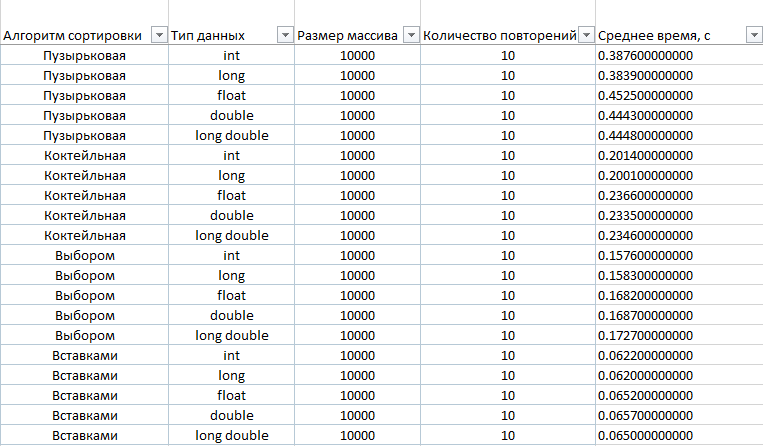

# Домашнее задание к работе 17

## Условие задачи
Проведите вычислительный эксперимент по одному из вариантов (пример протокола):
2) сравнение простых сортировок (выбором, пузырьковая, коктельная, вставками) для различных типов данных - int, long, float, double, long double  при фиксированном размере элементов массива

## 1. Алгоритм и блок-схема

### Алгоритм
1. **Начало**

2. **Конец**

### Блок-схема
 

## 2. Реализация программы

```
#define _CRT_SECURE_NO_WARNINGS
#include <stdio.h>
#include <locale.h>
#include <stdlib.h>
#include <time.h>
#include "arrays.h"
#include "sort.h"

double bubble_sort_time_int(int* ptr_array, int size);
double cocktail_sort_time_int(int* ptr_array, int size);
double selection_sort_time_int(int* ptr_array, int size);
double insertion_sort_time_int(int* ptr_array, int size);
double bubble_sort_time_long(long* ptr_array, int size);
double cocktail_sort_time_long(long* ptr_array, int size);
double selection_sort_time_long(long* ptr_array, int size);
double insertion_sort_time_long(long* ptr_array, int size);
double bubble_sort_time_float(float* ptr_array, int size);
double cocktail_sort_time_float(float* ptr_array, int size);
double selection_sort_time_float(float* ptr_array, int size);
double insertion_sort_time_float(float* ptr_array, int size);
double bubble_sort_time_double(double* ptr_array, int size);
double cocktail_sort_time_double(double* ptr_array, int size);
double selection_sort_time_double(double* ptr_array, int size);
double insertion_sort_time_double(double* ptr_array, int size);
double bubble_sort_time_ldouble(long double *ptr_array, int size);
double cocktail_sort_time_ldouble(long double* ptr_array, int size);
double selection_sort_time_ldouble(long double* ptr_array, int size);
double insertion_sort_time_ldouble(long double* ptr_array, int size);


int main(void) {

	setlocale(LC_CTYPE, "RUS");

	int array_int[10000];
	long array_long[10000];
	float array_float[10000];
	double array_double[10000];
	long double array_long_double[10000];

	long ltime = time(NULL) / 2;
	int stime = (unsigned)ltime;
	srand(stime);

	double time;
	double sum = 0;

	//BUBBLE SORT, INT

	printf("BUBBLE SORT, тип INT\n\n");

	for (int i = 0; i < 10; i++) {

		full_array_int(array_int, 10000);
		time = bubble_sort_time_int(array_int, 10000);
		sum += time;
	}
	printf("10000 элементов:\n\n");
	printf("Среднее время сортировки: %.12f секунд\n\n", sum / 10);
	sum = 0;

	//BUBBLE SORT, FLOAT

	printf("BUBBLE SORT, тип FLOAT\n\n");

	for (int i = 0; i < 10; i++) {

		full_array_float(array_float, 10000);
		time = bubble_sort_time_float(array_float, 10000);
		sum += time;
	}
	printf("10000 элементов:\n\n");
	printf("Среднее время сортировки: %.12f секунд\n\n", sum / 10);
	sum = 0;

	//BUBBLE SORT, DOUBLE

	printf("BUBBLE SORT, тип DOUBLE\n\n");

	for (int i = 0; i < 10; i++) {

		full_array_double(array_double, 10000);
		time = bubble_sort_time_double(array_double, 10000);
		sum += time;
	}
	printf("10000 элементов:\n\n");
	printf("Среднее время сортировки: %.12f секунд\n\n", sum / 10);
	sum = 0;

	//BUBBLE SORT, LONG

	printf("BUBBLE SORT, тип LONG\n\n");

	for (int i = 0; i < 10; i++) {

		full_array_long(array_long, 10000);
		time = bubble_sort_time_long(array_long, 10000);
		sum += time;
	}
	printf("10000 элементов:\n\n");
	printf("Среднее время сортировки: %.12f секунд\n\n", sum / 10);
	sum = 0;

	//BUBBLE SORT, LONG DOUBLE

	printf("BUBBLE SORT, тип LONG DOUBLE\n\n");

	for (int i = 0; i < 10; i++) {

		full_array_long_double(array_long_double, 10000);
		time = bubble_sort_time_ldouble(array_long_double, 10000);
		sum += time;
	}
	printf("10000 элементов:\n\n");
	printf("Среднее время сортировки: %.12f секунд\n\n", sum / 10);
	sum = 0;

	//COCKTAIL SORT, INT

	printf("COCKTAIL SORT, тип INT\n\n");

	for (int i = 0; i < 10; i++) {

		full_array_int(array_int, 10000);
		time = cocktail_sort_time_int(array_int, 10000);
		sum += time;
	}
	printf("10000 элементов:\n\n");
	printf("Среднее время сортировки: %.12f секунд\n\n", sum / 10);
	sum = 0;

	//COCKTAIL SORT, FLOAT

	printf("COCKTAIL SORT, тип FLOAT\n\n");

	for (int i = 0; i < 10; i++) {

		full_array_float(array_float, 10000);
		time = cocktail_sort_time_float(array_float, 10000);
		sum += time;
	}
	printf("10000 элементов:\n\n");
	printf("Среднее время сортировки: %.12f секунд\n\n", sum / 10);
	sum = 0;

	//COCKTAIL SORT, DOUBLE

	printf("COCKTAIL SORT, тип DOUBLE\n\n");

	for (int i = 0; i < 10; i++) {

		full_array_double(array_double, 10000);
		time = cocktail_sort_time_double(array_double, 10000);
		sum += time;
	}
	printf("10000 элементов:\n\n");
	printf("Среднее время сортировки: %.12f секунд\n\n", sum / 10);
	sum = 0;

	//COCKTAIL SORT, LONG

	printf("COCKTAIL SORT, тип LONG\n\n");

	for (int i = 0; i < 10; i++) {

		full_array_long(array_long, 10000);
		time = cocktail_sort_time_long(array_long, 10000);
		sum += time;
	}
	printf("10000 элементов:\n\n");
	printf("Среднее время сортировки: %.12f секунд\n\n", sum / 10);
	sum = 0;

	//COCKTAIL SORT, LONG DOUBLE

	printf("COCKTAIL SORT, тип LONG DOUBLE\n\n");

	for (int i = 0; i < 10; i++) {

		full_array_long_double(array_long_double, 10000);
		time = cocktail_sort_time_ldouble(array_long_double, 10000);
		sum += time;
	}
	printf("10000 элементов:\n\n");
	printf("Среднее время сортировки: %.12f секунд\n\n", sum / 10);
	sum = 0;

	//SELECTION SORT, INT

	printf("SELECTION SORT, тип INT\n\n");

	for (int i = 0; i < 10; i++) {

		full_array_int(array_int, 10000);
		time = selection_sort_time_int(array_int, 10000);
		sum += time;
	}
	printf("10000 элементов:\n\n");
	printf("Среднее время сортировки: %.12f секунд\n\n", sum / 10);
	sum = 0;

	//SELECTION SORT, FLOAT

	printf("SELECTION SORT, тип FLOAT\n\n");

	for (int i = 0; i < 10; i++) {

		full_array_float(array_float, 10000);
		time = selection_sort_time_float(array_float, 10000);
		sum += time;
	}
	printf("10000 элементов:\n\n");
	printf("Среднее время сортировки: %.12f секунд\n\n", sum / 10);
	sum = 0;

	//SELECTION SORT, DOUBLE

	printf("SELECTION SORT, тип DOUBLE\n\n");

	for (int i = 0; i < 10; i++) {

		full_array_double(array_double, 10000);
		time = selection_sort_time_double(array_double, 10000);
		sum += time;
	}
	printf("10000 элементов:\n\n");
	printf("Среднее время сортировки: %.12f секунд\n\n", sum / 10);
	sum = 0;

	//SELECTION SORT, LONG

	printf("SELECTION SORT, тип LONG\n\n");

	for (int i = 0; i < 10; i++) {

		full_array_long(array_long, 10000);
		time = selection_sort_time_long(array_long, 10000);
		sum += time;
	}
	printf("10000 элементов:\n\n");
	printf("Среднее время сортировки: %.12f секунд\n\n", sum / 10);
	sum = 0;

	//SELECTION SORT, LONG DOUBLE

	printf("SELECTIONSORT, тип LONG DOUBLE\n\n");

	for (int i = 0; i < 10; i++) {

		full_array_long_double(array_long_double, 10000);
		time = selection_sort_time_ldouble(array_long_double, 10000);
		sum += time;
	}
	printf("10000 элементов:\n\n");
	printf("Среднее время сортировки: %.12f секунд\n\n", sum / 10);
	sum = 0;

	//INSERTION SORT, INT

	printf("INSERTION SORT, тип INT\n\n");

	for (int i = 0; i < 10; i++) {

		full_array_int(array_int, 10000);
		time = insertion_sort_time_int(array_int, 10000);
		sum += time;
	}
	printf("10000 элементов:\n\n");
	printf("Среднее время сортировки: %.12f секунд\n\n", sum / 10);
	sum = 0;

	//INSERTION SORT, FLOAT

	printf("INSERTION SORT, тип FLOAT\n\n");

	for (int i = 0; i < 10; i++) {

		full_array_float(array_float, 10000);
		time = insertion_sort_time_float(array_float, 10000);
		sum += time;
	}
	printf("10000 элементов:\n\n");
	printf("Среднее время сортировки: %.12f секунд\n\n", sum / 10);
	sum = 0;

	//INSERTION SORT, DOUBLE

	printf("INSERTION SORT, тип DOUBLE\n\n");

	for (int i = 0; i < 10; i++) {

		full_array_double(array_double, 10000);
		time = insertion_sort_time_double(array_double, 10000);
		sum += time;
	}
	printf("10000 элементов:\n\n");
	printf("Среднее время сортировки: %.12f секунд\n\n", sum / 10);
	sum = 0;

	//INSERTION SORT, LONG

	printf("INSERTION SORT, тип LONG\n\n");

	for (int i = 0; i < 10; i++) {

		full_array_long(array_long, 10000);
		time = insertion_sort_time_long(array_long, 10000);
		sum += time;
	}
	printf("10000 элементов:\n\n");
	printf("Среднее время сортировки: %.12f секунд\n\n", sum / 10);
	sum = 0;

	//INSERTION SORT, LONG DOUBLE

	printf("INSERTION SORT, тип LONG DOUBLE\n\n");

	for (int i = 0; i < 10; i++) {

		full_array_long_double(array_long_double, 10000);
		time = insertion_sort_time_ldouble(array_long_double, 10000);
		sum += time;
	}
	printf("10000 элементов:\n\n");
	printf("Среднее время сортировки: %.12f секунд\n\n", sum / 10);
	sum = 0;


	return 0;
}

double bubble_sort_time_int(int* ptr_array, int size) {

	clock_t t = clock();

	bubble_sort_int(ptr_array, size);

	double time = (clock() - t) * 1. / CLOCKS_PER_SEC;

	return time;
}

double cocktail_sort_time_int(int* ptr_array, int size) {

	clock_t t = clock();

	cocktail_sort_int(ptr_array, size);

	double time = (clock() - t) * 1. / CLOCKS_PER_SEC;

	return time;
}

double selection_sort_time_int(int* ptr_array, int size) {

	clock_t t = clock();

	selection_sort_int(ptr_array, size);

	double time = (clock() - t) * 1. / CLOCKS_PER_SEC;

	return time;
}

double insertion_sort_time_int(int* ptr_array, int size) {

	clock_t t = clock();

	insertion_sort_int(ptr_array, size);

	double time = (clock() - t) * 1. / CLOCKS_PER_SEC;

	return time;
}

double bubble_sort_time_long(long* ptr_array, int size) {

	clock_t t = clock();

	bubble_sort_long(ptr_array, size);

	double time = (clock() - t) * 1. / CLOCKS_PER_SEC;

	return time;
}

double cocktail_sort_time_long(long* ptr_array, int size) {

	clock_t t = clock();

	cocktail_sort_long(ptr_array, size);

	double time = (clock() - t) * 1. / CLOCKS_PER_SEC;

	return time;
}

double selection_sort_time_long(long* ptr_array, int size) {

	clock_t t = clock();

	selection_sort_long(ptr_array, size);

	double time = (clock() - t) * 1. / CLOCKS_PER_SEC;

	return time;
}

double insertion_sort_time_long(long* ptr_array, int size) {

	clock_t t = clock();

	insertion_sort_long(ptr_array, size);

	double time = (clock() - t) * 1. / CLOCKS_PER_SEC;

	return time;
}

double bubble_sort_time_float(float* ptr_array, int size) {

	clock_t t = clock();

	bubble_sort_float(ptr_array, size);

	double time = (clock() - t) * 1. / CLOCKS_PER_SEC;

	return time;
}

double cocktail_sort_time_float(float* ptr_array, int size) {

	clock_t t = clock();

	cocktail_sort_float(ptr_array, size);

	double time = (clock() - t) * 1. / CLOCKS_PER_SEC;

	return time;
}

double selection_sort_time_float(float* ptr_array, int size) {

	clock_t t = clock();

	selection_sort_float(ptr_array, size);

	double time = (clock() - t) * 1. / CLOCKS_PER_SEC;

	return time;
}

double insertion_sort_time_float(float* ptr_array, int size) {

	clock_t t = clock();

	insertion_sort_float(ptr_array, size);

	double time = (clock() - t) * 1. / CLOCKS_PER_SEC;

	return time;
}

double bubble_sort_time_double(double* ptr_array, int size) {

	clock_t t = clock();

	bubble_sort_double(ptr_array, size);

	double time = (clock() - t) * 1. / CLOCKS_PER_SEC;

	return time;
}

double cocktail_sort_time_double(double* ptr_array, int size) {

	clock_t t = clock();

	cocktail_sort_double(ptr_array, size);

	double time = (clock() - t) * 1. / CLOCKS_PER_SEC;

	return time;
}

double selection_sort_time_double(double* ptr_array, int size) {

	clock_t t = clock();

	selection_sort_double(ptr_array, size);

	double time = (clock() - t) * 1. / CLOCKS_PER_SEC;

	return time;
}

double insertion_sort_time_double(double* ptr_array, int size) {

	clock_t t = clock();

	insertion_sort_double(ptr_array, size);

	double time = (clock() - t) * 1. / CLOCKS_PER_SEC;

	return time;
}

double bubble_sort_time_ldouble(long double* ptr_array, int size) {

	clock_t t = clock();

	bubble_sort_ldouble(ptr_array, size);

	double time = (clock() - t) * 1. / CLOCKS_PER_SEC;

	return time;
}

double cocktail_sort_time_ldouble(long double* ptr_array, int size) {

	clock_t t = clock();

	cocktail_sort_ldouble(ptr_array, size);

	double time = (clock() - t) * 1. / CLOCKS_PER_SEC;

	return time;
}

double selection_sort_time_ldouble(long double* ptr_array, int size) {

	clock_t t = clock();

	selection_sort_ldouble(ptr_array, size);

	double time = (clock() - t) * 1. / CLOCKS_PER_SEC;

	return time;
}

double insertion_sort_time_ldouble(long double* ptr_array, int size) {

	clock_t t = clock();

	insertion_sort_ldouble(ptr_array, size);

	double time = (clock() - t) * 1. / CLOCKS_PER_SEC;

	return time;
}
```

## 3. Результаты работы программы

```
BUBBLE SORT, тип INT

10000 элементов:

Среднее время сортировки: 0.387600000000 секунд

BUBBLE SORT, тип FLOAT

10000 элементов:

Среднее время сортировки: 0.452500000000 секунд

BUBBLE SORT, тип DOUBLE

10000 элементов:

Среднее время сортировки: 0.444300000000 секунд

BUBBLE SORT, тип LONG

10000 элементов:

Среднее время сортировки: 0.383900000000 секунд

BUBBLE SORT, тип LONG DOUBLE

10000 элементов:

Среднее время сортировки: 0.444800000000 секунд

COCKTAIL SORT, тип INT

10000 элементов:

Среднее время сортировки: 0.201400000000 секунд

COCKTAIL SORT, тип FLOAT

10000 элементов:

Среднее время сортировки: 0.236600000000 секунд

COCKTAIL SORT, тип DOUBLE

10000 элементов:

Среднее время сортировки: 0.233500000000 секунд

COCKTAIL SORT, тип LONG

10000 элементов:

Среднее время сортировки: 0.200100000000 секунд

COCKTAIL SORT, тип LONG DOUBLE

10000 элементов:

Среднее время сортировки: 0.234600000000 секунд

SELECTION SORT, тип INT

10000 элементов:

Среднее время сортировки: 0.157600000000 секунд

SELECTION SORT, тип FLOAT

10000 элементов:

Среднее время сортировки: 0.168200000000 секунд

SELECTION SORT, тип DOUBLE

10000 элементов:

Среднее время сортировки: 0.168700000000 секунд

SELECTION SORT, тип LONG

10000 элементов:

Среднее время сортировки: 0.158300000000 секунд

SELECTIONSORT, тип LONG DOUBLE

10000 элементов:

Среднее время сортировки: 0.172700000000 секунд

INSERTION SORT, тип INT

10000 элементов:

Среднее время сортировки: 0.062200000000 секунд

INSERTION SORT, тип FLOAT

10000 элементов:

Среднее время сортировки: 0.065200000000 секунд

INSERTION SORT, тип DOUBLE

10000 элементов:

Среднее время сортировки: 0.065700000000 секунд

INSERTION SORT, тип LONG

10000 элементов:

Среднее время сортировки: 0.062000000000 секунд

INSERTION SORT, тип LONG DOUBLE

10000 элементов:

Среднее время сортировки: 0.065000000000 секунд
```


## 4. Информация о разработчике

Лупачев Сергей бТИИ-262
